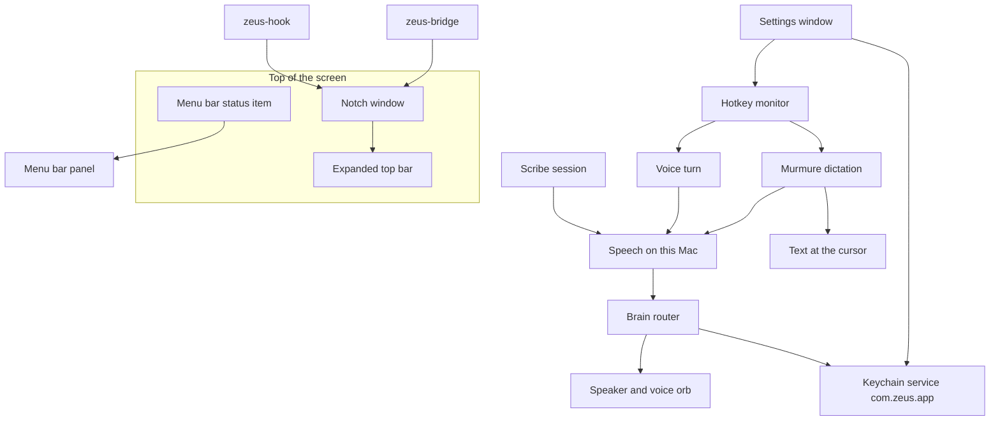

# Zeus

Zeus is a native macOS application. It lives in the menu bar, and on a display with a notch it also occupies the top centre of the screen. Hold a key to talk to it, dictate into the app you are already using, or keep a meeting transcript. Speech starts on this Mac. A networked model or voice runs only when you choose one, and its key stays in the Keychain.

The five pictures named below are not in this repository. They are placeholders for captures made on a Mac. Nothing on this page is a substitute for the acceptance map in `qa/feature-map.json`.

## What it is

`AppDelegate` creates a menu-bar status item at launch and leaves it visible, including on displays that have no notch (`Sources/Zeus/App/AppDelegate.swift`). `NotchController` owns a borderless window per display, placed over the menu bar at the top centre. On a Mac without a hardware notch that window is a pill. While the panel is closed the window is click-through (`Sources/Zeus/Notch/NotchController.swift`).

The closed shape opens into the top bar. The default trigger is hover; Settings can switch that to click (`notch.openTrigger` in `Sources/Zeus/App/SettingsCatalog.swift`, rules in `Sources/ZeusCore/TopBar/NotchOpenTrigger.swift`). The pages are `TopBarTab` (`Sources/ZeusCore/TopBar/TopBarLayout.swift`). Home stays first. The default row continues with tiling, agents, chat, alerts, clipboard, shelf, to-do, Murmure, prompter, insomnia, polyglot, record, and Scribe. Other pages stay available from Settings.

A left click on the menu-bar icon opens a separate borderless panel under the icon (`MenuBarPanel` in `Sources/Zeus/App/MenuBarPanel.swift`). Escape closes that panel. A right click opens the menu that contains Settings.

## Voice

A voice turn is one hold of a talk key. `HotkeyMonitor` feeds `VoiceKeyMachine`. The talk role calls `AppDelegate.talkKeyPressed`, which starts `VoiceTurnController` only when microphone access is already granted (`Sources/Zeus/Voice/HotkeyMonitor.swift`, `Sources/Zeus/App/VoiceTurnController.swift`). Release ends the hold. The transcript is routed by `Router` (`Sources/Zeus/Brain/Router.swift`). `Speaker` speaks the reply (`Sources/Zeus/Voice/Speaker.swift`). Live words are captioned beside the spark.

Two personalities are stored under `voice.personality` (`ZeusPersonality` in `Sources/ZeusCore/Persona/ZeusVoiceLines.swift`):

| Personality | Role |
| --- | --- |
| Ultron | Default. The instructions in `ZeusPersona` (`Sources/Zeus/Brain/ZeusPrompt.swift`) and the stock lines in `ZeusVoiceLines`. |
| Plain | Short, neutral answers. |

Some replies are those stock lines and never leave the Mac. Anything that needs a model goes through a provider under `Sources/Zeus/Brain/Providers/` or a local command the router can reach. Provider secrets are read from the Keychain and are not written into the repository (`Sources/ZeusCore/Keychain/KeychainStore.swift`).

The voice orb is the mark for that turn. Its drawing is Mascot, Ring, or Mono ring (`VoiceOrbStyle` in `Sources/ZeusCore/Voice/VoiceRingModel.swift`, painted from `Sources/Zeus/Avatar/Avatar.swift` and `Sources/Zeus/Voice/VoiceRingView.swift`). The setting is on the Voice page.

### Talking to Zeus

Both talk keys start the same turn (`VoiceKey.owner` in `Sources/ZeusCore/VoiceKey.swift`).

| Key | Default | Behaviour |
| --- | --- | --- |
| Talk to Zeus | Control-Option | Hold to ask, release to send (`ShortcutStore.talkDefault` in `Sources/ZeusCore/Shortcut.swift`). |
| Second talk key | Right Option | The same hold, after a quarter of a second, so Option plus a letter still types (`ShortcutStore.secondTalkDefault`, `VoiceKey.secondKeyConfirm`). Double-tap keeps listening. |
| Dictation | Right Command | Covered under Murmure. It is a different key, and it types instead of answering. |

While VoiceOver is running, a Control-Option talk key moves to the first fallback that dictation and pointing are not using (`VoiceKey.effectiveTalkKey`). The second key gives way when it would repeat the talk key or collide with dictation. The Shortcuts page states the collision (`Sources/Zeus/Settings/GlanceSettingsPages.swift`).

If Screen Recording is allowed, and sight is left on, the turn can attach the screen. Without that permission the turn still runs (`VoiceKey.Owner.talk(screenAware:)`). Drawing marks on screen is a separate switch and is off unless turned on (`VoiceTurnController`).

The phrase "Hey Zeus" is off until enabled (`wake.enabled` defaults to false in `Sources/Zeus/Voice/WakeWordController.swift`).

## Murmure

Murmure is dictation. The top-bar tab title is Murmure (`TopBarTab.dictation`). The default key is Right Command (`ShortcutStore.loadDictation`). The Shortcuts page says: hold to speak, let go to write it where the cursor is. Dictation is enabled by default (`DictationSettings` in `Sources/Zeus/Dictation/DictationController.swift`).

The dictation strip in the top bar reads `DictationDisplay`: phase, partial text, level, and a cue (`Sources/Zeus/Dictation/DictationDisplay.swift`). The pill's orb is `ThinkingOrbView`. It follows the microphone level, and under Reduce Motion it pulses instead of drawing the dotted sphere (`Sources/Zeus/Voice/ThinkingOrb.swift`).

The Murmure settings page is `GSSection.murmure` (`Sources/Zeus/Settings/GlanceSettingsPages.swift`). It holds the enable switch, the speech engine, the shortcut link, language, and the start and stop cue. Microphone and Accessibility are required before dictation can type into another app.

## Scribe

Scribe listens to a meeting and writes notes (`TopBarTab.scribe`). `ScribeController.start` opens one session (`Sources/Zeus/Scribe/ScribeController.swift`). A second start is refused while a session is active. The default when a meeting is seen is Ask me (`ScribeAutoStartMode.ask` in `Sources/ZeusCore/Scribe/ScribeAutoStart.swift`). Starting automatically is a different choice, on the Scribe card in Settings › Features (`Sources/Zeus/Settings/GSFeaturesPage.swift`).

An explicit Stop ends the session. A later suggestion that the call looks over does not stop capture by itself (`docs/SCRIBE-PRIVACY-AND-END-FLOW.md`). An optional on-device model can separate voices. Zeus does not ask for Accessibility on its own in order to read names from a call window (`Sources/Zeus/Settings/GSSpeakerRecognitionCard.swift`).

## Settings

Settings is a window of 1080 by 780 points, with a sidebar and a page (`GlanceSettingsWindowController` in `Sources/Zeus/Settings/GlanceSettingsWindow.swift`). Open it from the menu-bar menu (Settings…), from the button on the menu-bar panel, or from the top bar. If the status item cannot be seen, opening Zeus again shows Settings (`AppDelegate.applicationShouldHandleReopen`).

The sidebar groups are Settings, Your tools, and Zeus (`GSSection.Group`). The pages this README depends on:

| Page | What it controls |
| --- | --- |
| Shortcuts | Talk to Zeus, the Right Option second key, dictation. |
| Murmure | Dictation on or off, engine, language, cues. |
| Voice | Personality, orb, talk shortcut, microphone. |
| Features | Scribe's "When a meeting starts". |
| Privacy | Detail on cards, lyrics, driving the Mac, command-line control. |
| Permissions | The system prompts Zeus can request. |
| About | Version line and the privacy summary. |

The iPhone page is hidden until pairing exists (`GSSection.iPhonePairingAvailable`).

## Local speech, optional providers, keys

Dictation's engine list is `TranscriptionEngineKind` (`Sources/ZeusCore/Dictation/TranscriptionEngine.swift`). Engines are grouped "On this Mac" and "Cloud". Cloud engines are used only when chosen. Their audio leaves the Mac, and they read a key from the Keychain at the moment they run (`Sources/Zeus/Dictation/CloudSpeechEngines.swift`). The default dictation engine is the on-device choice stored by `DictationSettings`; until that model is present, the recognizer built into macOS fills in. Voice turns keep that recognizer unless "use the dictation engine for voice" is turned on (`dictation.engineForVoice` defaults to false).

Spoken replies use the Mac synthesizer. Networked voices are optional and run only when their key is already in the Keychain (`Speaker`).

Every secret Zeus stores uses one Keychain service, `com.zeus.app` (`KeychainStore`). The cache is loaded at launch. Reads ask for no password dialog: a locked or foreign item comes back as missing. The About page states the rule in one place: audio and saved voices stay on this Mac unless a cloud engine is chosen, API keys stay in the Keychain, and Zeus has no telemetry (`AboutInfo.privacySummary` in `Sources/Zeus/Settings/GSAboutPage.swift`).

## Privacy and security

Permission prompts belong to macOS. `PermissionsModel` tracks microphone, speech recognition, Accessibility, camera, screen recording, calendar, reminders, and automation (`Sources/Zeus/App/PermissionsModel.swift`). Tests, the closed-loop runner, and the capture script in this repository do not approve those prompts and do not relax them.

Other boundaries that are in the source:

- `zeus-hook` forwards a coding tool's hook to the app and waits for a person to decide a permission request. If Zeus is not running, or nobody answers, it prints nothing. It does not allow the request itself (`Sources/zeus-hook/main.swift`).
- Command-line control of sensitive actions is off by default and is stored in the Keychain, not in a preferences file (Privacy page in `Sources/Zeus/Settings/GlanceSettingsPages.swift`).
- Synced lyrics send song metadata off the Mac and stay off until enabled (`privacy.lyrics`).
- The wake phrase is off until enabled.
- A QA launch (`--qa-startup`) keeps the status item and denies the notch, panel, dictation, voice turn, and the other services in `StartupPolicy` (`Sources/ZeusCore/StartupPolicy.swift`).

`zeus-bridge` is a native-messaging host. It relays framed messages to the app and does not call a provider (`Sources/zeus-bridge/main.swift`). The extension sources live in `extension/`.

## How a turn is put together



`ZeusCore` holds the contracts those boxes share: shortcuts, the voice-key machine, reply tags, hook and bridge envelopes, the speech-engine enum, and the Keychain store. The app target is the windows, the monitors, and the providers.

## Pictures

These files are not committed. Each block is a placeholder for one capture. The shot list, the opt-in, and the refusal rules are in [`docs/media/README.md`](docs/media/README.md) and `scripts/capture-readme-gifs.sh`.

<!-- media-placeholder: docs/media/idle-top-bar.gif -->

**Idle top bar.** `docs/media/idle-top-bar.gif`

The closed notch, or the pill on a Mac without one. Nothing expanded. On a Mac: `scripts/capture-readme-gifs.sh --record idle-top-bar --region X,Y,W,H`.

<!-- media-placeholder: docs/media/expanded-panel.gif -->

**Expanded panel.** `docs/media/expanded-panel.gif`

The open top bar: tab row and one page. On a Mac: `scripts/capture-readme-gifs.sh --record expanded-panel --region X,Y,W,H`.

<!-- media-placeholder: docs/media/murmur-dictation.gif -->

**Murmure dictation.** `docs/media/murmur-dictation.gif`

Right Command held, with the live words and the orb in the top bar. On a Mac: `scripts/capture-readme-gifs.sh --record murmur-dictation --region X,Y,W,H`.

<!-- media-placeholder: docs/media/voice-orb.gif -->

**Voice orb.** `docs/media/voice-orb.gif`

The orb while a talk turn is listening or speaking. Right Option is the default second talk key. On a Mac: `scripts/capture-readme-gifs.sh --record voice-orb --region X,Y,W,H`.

<!-- media-placeholder: docs/media/settings.gif -->

**Settings.** `docs/media/settings.gif`

The Settings window, on Voice or Murmure. On a Mac: `scripts/capture-readme-gifs.sh --record settings --region X,Y,W,H`.

## Modules

From `Package.swift`. The tools version is Swift 6.0 and the platform is macOS 14.2.

| Path | Product | Role |
| --- | --- | --- |
| `Sources/Zeus` | `Zeus` | The app. AppKit windows, SwiftUI pages, voice, dictation, Scribe, settings. |
| `Sources/ZeusCore` | `ZeusCore` | Shared contracts and pure machines. No UI. |
| `Sources/ZeusFling` | `ZeusFling` | Nearby-Mac file transfer. Swift 5 mode for the network callbacks. |
| `Sources/ZeusObjCGuard` | `ZeusObjCGuard` | Catches Objective-C exceptions Swift cannot catch. |
| `Sources/zeus-hook` | `zeus-hook` | Hook process. Forwards events. Never allows on its own. |
| `Sources/zeus-bridge` | `zeus-bridge` | Native-messaging host for `extension/`. |
| `Sources/zeus-cli` | `zeus-cli` | Installed as the `zeus` command. |
| `Sources/zeus-silent-eval` | `zeus-silent-eval` | Evaluation helper. |
| `qa/native-app-host` | `zeus-native-test-host` | Test-only AppKit host. Not part of the app bundle. |
| `qa/fling-peer` | `zeus-fling-peer` | Test-only peer. Not part of the app bundle. |
| `extension/` | | Browser extension sources. |
| `Tests/ZeusCoreTests` | | Core tests. |
| `Tests/ZeusAppTests` | | App tests. |

Bundled avatar frames, fonts, sounds, and personality text are resources of the `Zeus` target.

## Build and test

Building the app needs macOS, Swift 6, and the platform declared in `Package.swift`. The app job in `.github/workflows/build.yml` selects its Xcode on `macos-15` and runs `swift build`. Linux cannot build the native application. The portable harness below is the check that runs there, and it does not prove the app.

From the repository root, on a Mac:

```sh
swift build
scripts/test.sh
swift test --filter SuiteName
scripts/bundle.sh
```

`scripts/test.sh` builds the test-only fling peer, then runs `swift test`. It deletes throwaway preference domains created by tests. It does not install Zeus and it does not answer a permission prompt.

`scripts/bundle.sh` writes `build/Zeus.app` and signs it. A local preview is not a notarized release. Installing, signing for distribution, and notarizing stay outside ordinary build and test commands (`scripts/package.sh`, `scripts/install.sh`).

The extension is separate: `cd extension && npm ci && npm run build`.

## QA

The gate is `./tools/check.sh`. It needs Python 3.11+ and Swift 6. With no arguments it runs development checks and prints a new evidence directory under `/tmp`. That directory is kept on success and on failure.

```sh
./tools/check.sh
./tools/check.sh development --output /tmp/zeus-development-NEW
./tools/check.sh --mode full --output /tmp/zeus-full-NEW
```

Development mode runs the portable contracts and the gate's own tests. It can pass while native and device proof is still missing. Full mode evaluates every obligation in `qa/feature-map.json`. A missing native, device, or signing proof stays blocked or unimplemented, and the run fails. There is no switch that turns a missing proof into a pass (`qa/closed-loop/README.md`, `docs/CLOSED-LOOP-QA.md`).

| Path | What it is |
| --- | --- |
| `qa/feature-map.json` | The acceptance obligations. A contract pass is not device acceptance. |
| `qa/regressions.json` | Named guards. Each one points at a real test. |
| `qa/closed-loop/` | The runner (`run.py`) and its tests. Output directories must be new. |
| `qa/portable-core/` | Synthetic Swift packages for Linux and for the portable groups. |
| `qa/release-scripts/` | Failure paths for packaging and install, with stand-in tools. |
| `tools/check.sh` | The single entry the wrapper forwards to the runner. |

The runner does not install Zeus, request permission, capture the screen, open a personal vault, or sign a release. An old receipt does not cover a new commit.

## Contributing

Cut the branch from `codex/integration-20261111`.

1. Start red. Add a test that fails on the current tree and names the behaviour. `swift test --filter` that test before changing production code. A regression is recorded in `qa/regressions.json` with that test function, and a feature obligation stays bound in `qa/feature-map.json` (`docs/CLOSED-LOOP-QA.md`).
2. Make the smallest change that turns the test green. Keep the diff on that behaviour.
3. Run the suite that maps to the change. On a Mac that is `swift test` or `scripts/test.sh`. For a portable contract, run the matching `qa/portable-core` group. Then run `./tools/check.sh` and keep the evidence directory it prints.
4. Open a draft pull request into `codex/integration-20261111`. Do not force-push. A reviewer reads the change and the evidence from this commit. A passing sentence, a test count, or an older receipt is not that evidence (`AGENTS.md`).

Do not capture the microphone, the screen, or system audio as part of a test. Use synthetic records, generated audio, and a disposable vault. Do not open a personal vault, reuse a provider key, or send a message to a person. Leave installed copies of Zeus alone unless the task is an install, and keep a rollback copy before replacing one.
