<p align="center">
  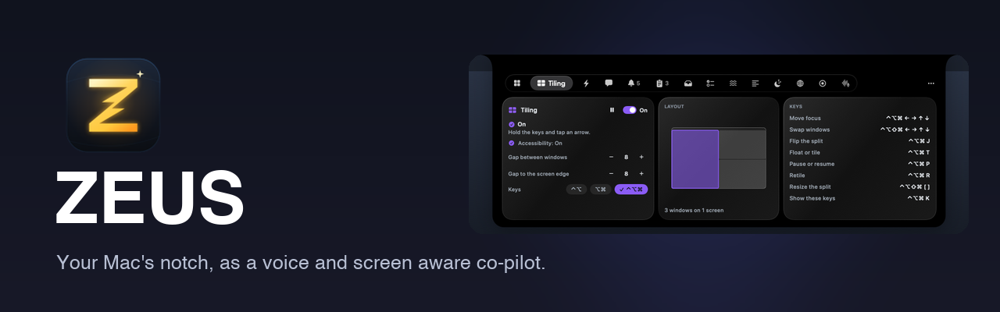
</p>

<p align="center">
  <b>Your Mac's notch, turned into a voice and screen aware co-pilot.</b><br>
  Talk to it, point at things, watch your coding agents, record meetings, and stay in flow.
</p>

<p align="center">
  
  
  
  
  
  <a href="https://github.com/mysticalsin/Zeus-native/releases"></a>
</p>

<p align="center">
  <a href="#what-it-does">What it does</a> ·
  <a href="#how-it-works">How it works</a> ·
  <a href="#keyboard-shortcuts">Shortcuts</a> ·
  <a href="#privacy">Privacy</a> ·
  <a href="docs/SHOWCASE.md">Every screen</a> ·
  <a href="#highlights">Highlights</a> ·
  <a href="#download">Download</a> ·
  <a href="#status">Status</a> ·
  <a href="#layout">Layout</a> ·
  <a href="#build">Build</a>
</p>

<p align="center">
  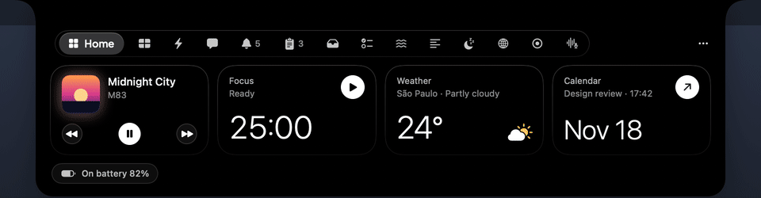
</p>

> ZEUS routes every request through **your own** AI tools (Claude Code, Codex, Gemini, cursor-agent, Ollama)
> and the Dust API. No account, no cloud of ours, no telemetry.

---

## What it does

<table>
<tr>
<td width="50%" valign="top">

### Talk, and it answers
Hold your talk key, speak, let go. ZEUS hears you on device, thinks with the brain you chose, and answers out
loud in its own voice, with a caption next to the spark.

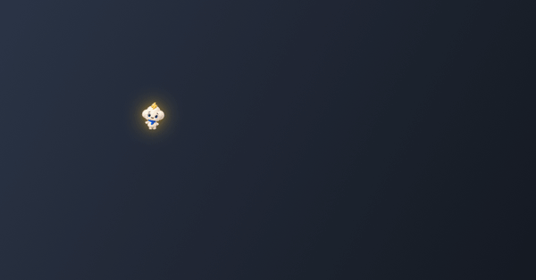

</td>
<td width="50%" valign="top">

### It lives in your notch
Music, focus timer, weather, agenda, to-dos, clipboard, teleprompter, recording and more, one hover away.
Pick a home style that fits your desk.

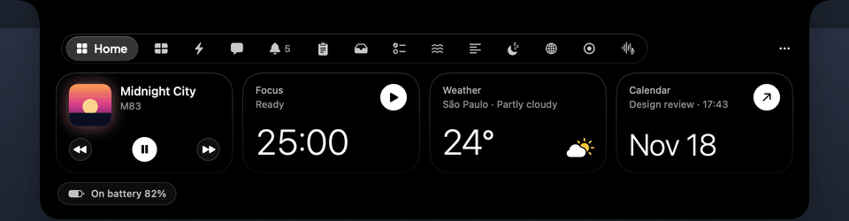

</td>
</tr>
<tr>
<td width="50%" valign="top">

### Your coding agents, supervised
Claude Code, Codex and Cursor report into the notch: running, done, stalled, failed. Risky commands wait
for your **Approve** or **Deny**, with a countdown, and never block the rest of your screen.

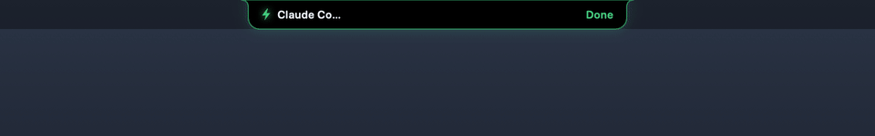

</td>
<td width="50%" valign="top">

### Meetings, without the fuss
Two minutes before a call, a compact card offers to record. Teams, Zoom and Meet links are found even
inside Outlook Safe Links. Scribe transcribes on device and names the speakers.

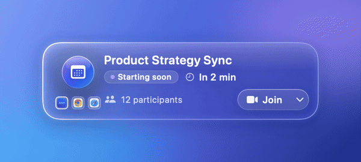

</td>
</tr>
<tr>
<td width="50%" valign="top">

### A face for every state
Idle, listening, thinking, speaking, pointing, typing, browsing, waiting on an agent, done.
You always know what ZEUS is doing at a glance.

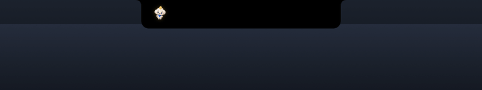

</td>
<td width="50%" valign="top">

### Light that means something
Halos and entrance lights for volume, copy, caps lock, battery, reminders and timers, tuned to stay out of
your way and to respect Reduce Motion.

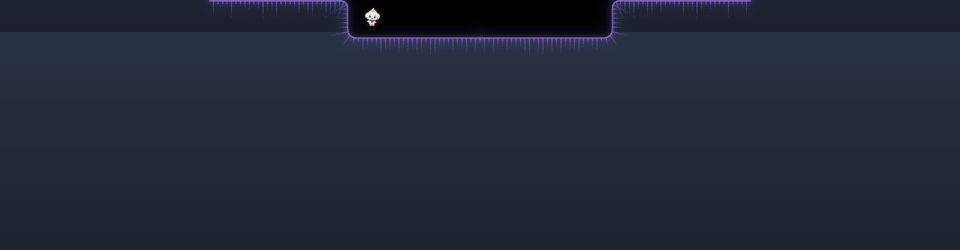

</td>
</tr>
<tr>
<td width="50%" valign="top">

### Record your screen
Recordly captures a display, window or area from the notch, with a countdown, a live timer and a Stop
button. Cursor follow and a polished export are part of it.

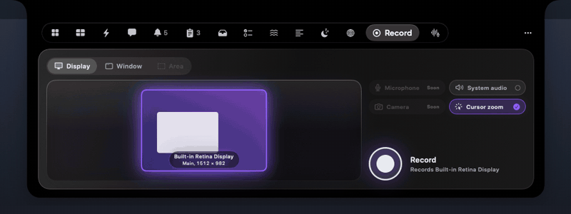

</td>
<td width="50%" valign="top">

### Fling files to your other Mac
Drop files on the Shelf, then send them to a nearby Mac. The receiving Mac gets a card with Accept or
Decline, and an offer that nobody answers declines by itself.

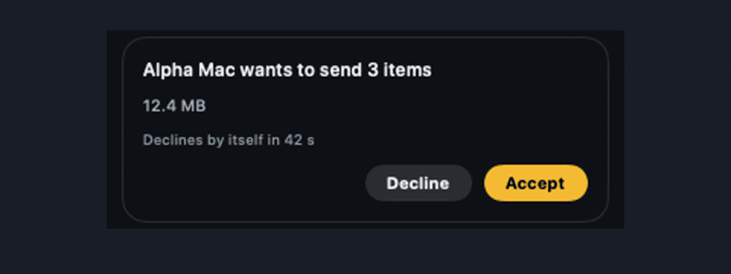

</td>
</tr>
<tr>
<td width="50%" valign="top">

### Tile your windows
Keyboard window layouts from the notch: move focus, swap windows, flip the split, adjust gaps, and pause
or resume tiling when you need a free hand.

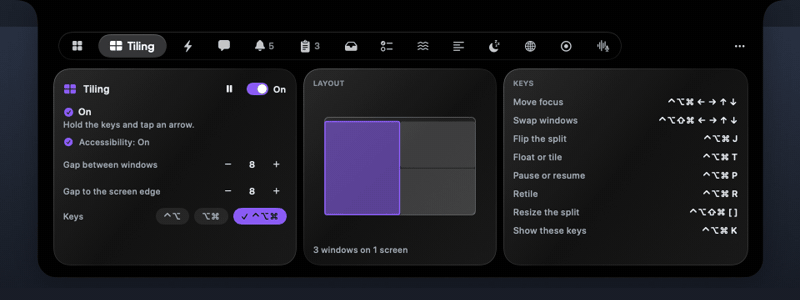

</td>
<td width="50%" valign="top">

### Dictate anywhere
Hold the dictation key, speak, release to type. Pick Voice, Message, Email, Note or Agent prompt, and keep
a short history you can copy from.

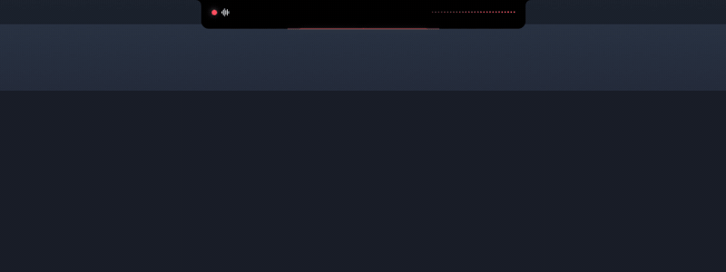

</td>
</tr>
</table>

### Approvals that respect your screen

<p align="center">
  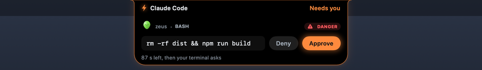
</p>

### Your day, in one card

<p align="center">
  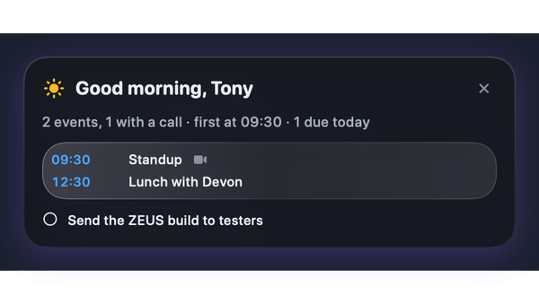
</p>

**[See every screen](docs/SHOWCASE.md)**: the full gallery, from notch pages to Settings and onboarding.

---

## How it works

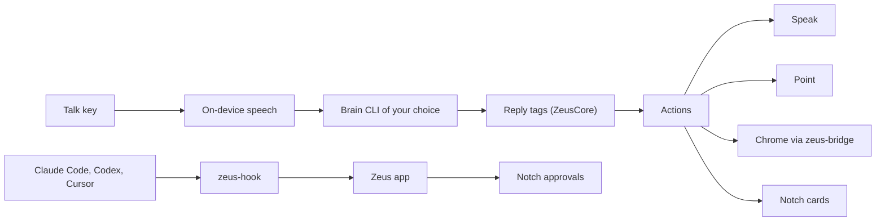

The brain is one of Claude Code, Codex, Gemini, cursor-agent or Ollama, or the Dust API. The shared
contracts (brain provider, reply tags, hook and bridge envelopes) live in `Sources/ZeusCore`, the menu-bar
app is `Sources/Zeus`, coding agents call `Sources/zeus-hook`, and the Chrome extension in `extension/`
talks to the app through `Sources/zeus-bridge`. See [Layout](#layout) for the full map.

## Keyboard shortcuts

| Keys | Action |
| --- | --- |
| Control+Option, right Option, right Command or Fn (your choice in Settings) | Talk key: hold, speak, let go |
| Hold Control and draw | Show me: ZEUS sees what you circled |
| Escape | Close the panel |
| ⌘, | Open Settings |

Control+Option is refused while VoiceOver is on, since VoiceOver uses it.

## Privacy

- No telemetry, and no account.
- Keys live only in the macOS Keychain, never in the repo.
- Nothing is captured without your OS consent. First launch asks for one permission per step, each
  explained before macOS asks, and nothing is requested at launch.
- Speech recognition and Scribe transcription run on device.
- `zeus-hook` never answers `allow` on its own, and Chrome typing is never done into password or card fields.

---

## Highlights

| | |
| --- | --- |
| 🎙️ **Voice** | Push to talk on the key you choose, on-device recognition, ElevenLabs voice with Kokoro as an offline failsafe |
| 👉 **Show me** | Hold Control and draw on screen; ZEUS sees what you circled |
| 🤖 **Agents** | Live status, approvals, diffs and plans from Claude Code, Codex and Cursor |
| 📝 **Scribe** | Meeting detection, compact start card, on-device transcription and speaker names |
| 🎬 **Recordly** | Screen recording with cursor follow and a polished export |
| 🌍 **Polyglot** | Listens and translates while it runs |
| 📋 **Shelf and Fling** | Drop files in the notch, send them to your other Mac |
| 🪟 **Tiling** | Keyboard window layouts from the notch |
| 🔒 **Private by design** | No telemetry, keys only in the Keychain, nothing captured without your OS consent |

## Download

Builds are attached to the [GitHub releases](https://github.com/mysticalsin/Zeus-native/releases).
Current DMGs are **local previews**: ad hoc signed and not yet notarized, so macOS asks for confirmation
on first open. A notarized release follows the steps in [Release and installation](#release-and-installation).

## Status

Development is in progress. A passing subset of tests does not establish native feature completion or a sellable release. The [acceptance map](qa/feature-map.json) and [closed-loop verification guide](docs/CLOSED-LOOP-QA.md) track what is executable, unverified, or still missing. Verification is automated; no manual click-through substitutes for a missing check.

All images on this page are rendered by the app itself with `Zeus --snapshots <dir>` from built-in fixtures.

## Layout

| Path | What |
| --- | --- |
| `Sources/ZeusCore` | Shared contracts: brain provider, reply tags, hook and bridge envelopes, native-messaging framing |
| `Sources/Zeus` | The menu-bar app (AppKit + SwiftUI) |
| `Sources/zeus-hook` | CLI that Claude Code / Codex / Cursor hooks call |
| `Sources/zeus-bridge` | Chrome native-messaging host `com.zeus.bridge` |
| `extension/` | ZEUS Chrome extension (MV3, TypeScript, esbuild) |
| `scripts/` | `test.sh`, `bundle.sh` |

## Build

Runs on macOS 14.2+. Building the current sources requires Swift 6 and the macOS 26 SDK
(Xcode 26.1.1 in CI); newer speech and translation features remain availability-gated at runtime.

```sh
swift build
scripts/test.sh                 # uses the selected Xcode/Command Line Tools toolchain
scripts/bundle.sh               # → build/Zeus.app (ad-hoc signed)
open build/Zeus.app
cd extension && npm ci && npm run build
```

## Rules

- No telemetry. Keys go in the macOS Keychain, never in the repo.
- Nothing is copied from other apps: behaviour only, never assets, sounds, prompts or names.
- Third-party code keeps its licence notice (see `NOTICES.md`).
- `zeus-hook` never answers `allow` on its own.

## Chrome

Click **Connect Chrome** in the ⚡ panel. It registers `zeus-bridge` as Chrome's `com.zeus.bridge`
native host (only extension `dkpclhaealkdnnihlccglmonmmjfjobe` may start it) and opens
chrome://extensions plus the `ChromeExtension` folder: turn on Developer mode → Load unpacked →
pick that folder. Then, with Chrome in front, ZEUS reads the active tab, and can open pages,
click and type (asked once per site in the notch, never into password or card fields), and send
prompts to ChatGPT, Claude or Dust in your logged-in tabs.

Debug: `build/Zeus.app/Contents/MacOS/Zeus --chrome page.context` sends one raw bridge request.

## Logo

`Design/zeus-icon.svg` is the source: a Z drawn as a lightning bolt on a storm-dark tile. Rendered to
`Resources/AppIcon.icns` (app), `Resources/MenuBarTemplate*.png` (template image, tinted by macOS),
`Resources/Logo.png` (panel, setup) and `extension/icons/` (Chrome).

## Ease of use (Apple HIG)

- First launch opens **Set Up ZEUS**: one step per permission, each explained before macOS asks,
  one Continue button, skippable, reopenable from the panel or the menu. Nothing is requested at launch.
- Talk key is your choice (Settings): Control+Option, right Option, right Command or Fn. Control+Option
  is refused while VoiceOver is on, since VoiceOver uses it.
- Everything ZEUS says is also captioned next to the spark (Settings › Show captions).
- Reduce Motion: the spark jumps instead of flying, the notch glows steadily, no strike ring.
- Approvals show a countdown and what happens at zero; VoiceOver announces them; no default button.
- Status uses symbol + word, not colour alone; text meets 4.5:1 contrast; buttons are 28 pt with press
  and focus states; Escape closes the panel; ⌘, opens Settings; the menu bar icon can be hidden and
  reopening ZEUS brings Settings back.

## Tests

- `scripts/test.sh`: unit tests.
- `scripts/e2e.sh`: 27 end-to-end checks on the built app: the Chrome bridge in an isolated Chrome for
  Testing profile, hook merge on a *copy* of your settings, real `claude` sessions approved and denied
  in the notch, and real Claude turns emitting the right actions.
- `Zeus --snapshots <dir>`: renders every notch, spark, panel and setup state to PNG.
- `scripts/package.sh`: builds `build/ZEUS.dmg`.
- `python3 qa/release-scripts/test_release_scripts.py`: release and rollback failure paths with mock tools; no real install or capture.

## Release and installation

Ordinary bundles and DMGs are local previews. They do not establish notarization or Gatekeeper readiness.
After choosing the release version/build in `Resources/Info.plist`, configure your own Developer ID identity
and a `notarytool` keychain profile on the signing Mac, then run:

```sh
RELEASE=1 SIGN_IDENTITY="Developer ID Application: Your Name (TEAMID)" \
  NOTARY_PROFILE="zeus-release" scripts/package.sh
```

Release mode verifies hardened runtime, Developer ID and secure timestamps, submits the app and DMG,
staples both, and assesses both with Gatekeeper before publishing `build/ZEUS.dmg`. Notary receipts and
the DMG SHA-256 stay in `build/`. A failure preserves the previous DMG. This must still be followed by
a clean-machine launch and feature QA using the user's own OS consent.

To install a prepared app, quit Zeus and run `scripts/install.sh build/Zeus.app`. It verifies the new
bundle and creates a checked rollback copy under `~/Library/Application Support/Zeus/Rollbacks` before
replacing `/Applications/Zeus.app`. It restores the previous app if replacement fails, never deletes
old rollback copies, and does not launch the app or answer permission prompts.
