# ZEUS showcase

Every image on this page is rendered by the app itself with `Zeus --snapshots <dir>` from built-in fixtures.
Back to the [README](../README.md).

- [Notch island pages](#notch-island-pages)
- [Agents](#agents)
- [Meetings and Scribe](#meetings-and-scribe)
- [Voice and avatar](#voice-and-avatar)
- [Recordly](#recordly)
- [Fling and Shelf](#fling-and-shelf)
- [Tiling](#tiling)
- [Dictation and Polyglot](#dictation-and-polyglot)
- [Settings](#settings)
- [Onboarding](#onboarding)
- [Lights and halos](#lights-and-halos)

## Notch island pages

One hover opens the island. Pages cover Home, Today, Agents, Chat, Music, Calendar, Focus, Teleprompter, Recordly, Scribe, Tiling, Shelf and Polyglot.

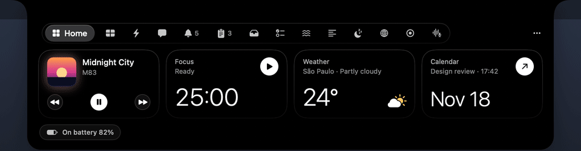

| Home | Music |
| --- | --- |
| 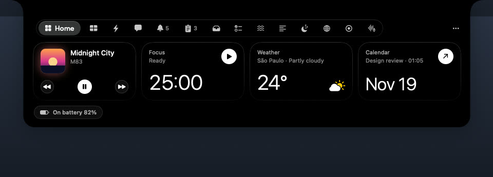 | 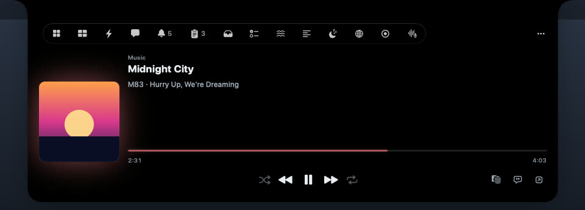 |

| Clipboard | Chat |
| --- | --- |
| 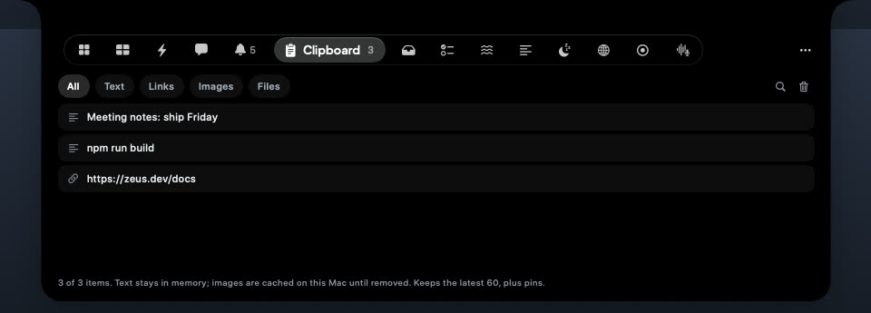 | 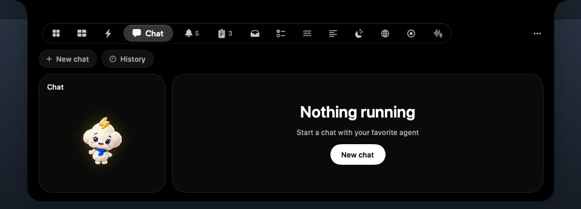 |

Six home styles are available:

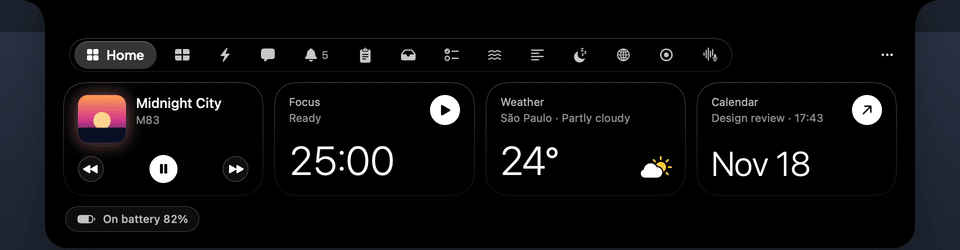

## Agents

Claude Code, Codex and Cursor report into the notch. Risky commands wait for **Approve** or **Deny**, with a countdown.

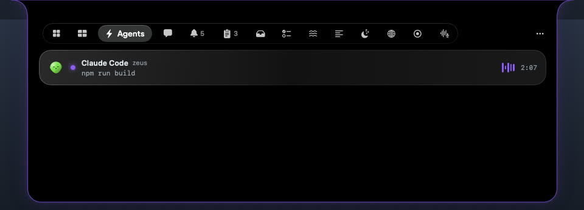

## Meetings and Scribe

A compact card offers to record before a call. Scribe transcribes on device and names the speakers.

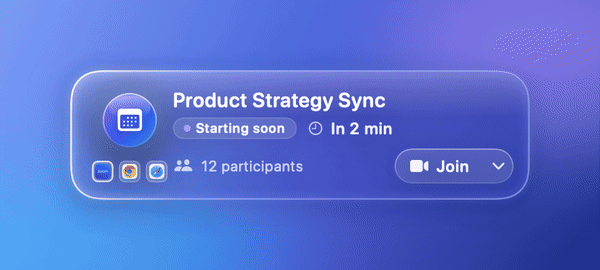

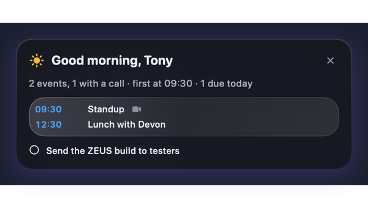

## Voice and avatar

Hold the talk key, speak, let go. The spark shows what ZEUS is doing, and the avatar shows its state.

## Recordly

Capture a display, window or area from the notch.

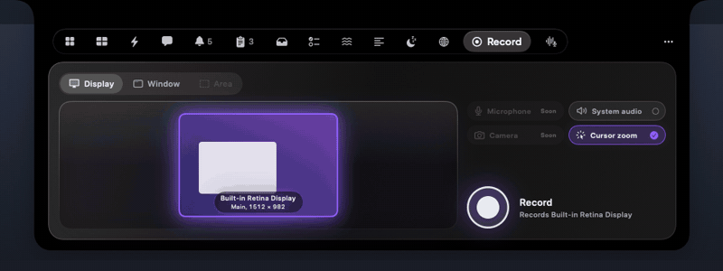

## Fling and Shelf

Drop files on the Shelf and send them to a nearby Mac. The other Mac gets an Accept or Decline card.

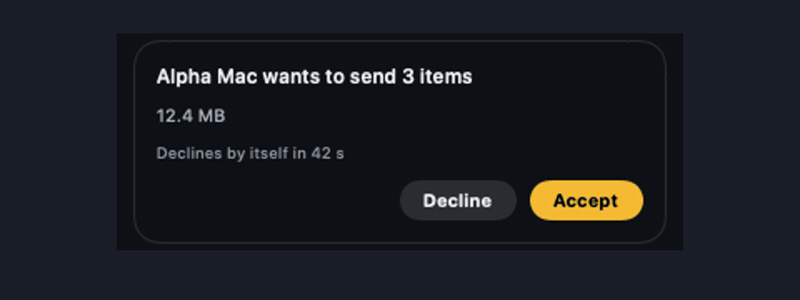

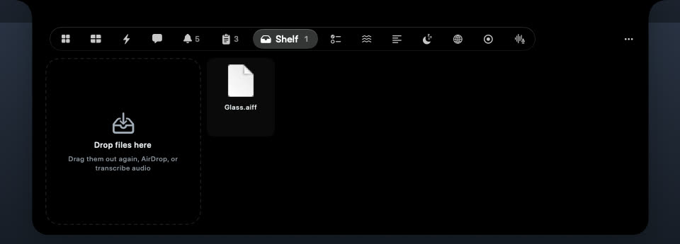

## Tiling

Keyboard window layouts, with a layout preview and a key map.

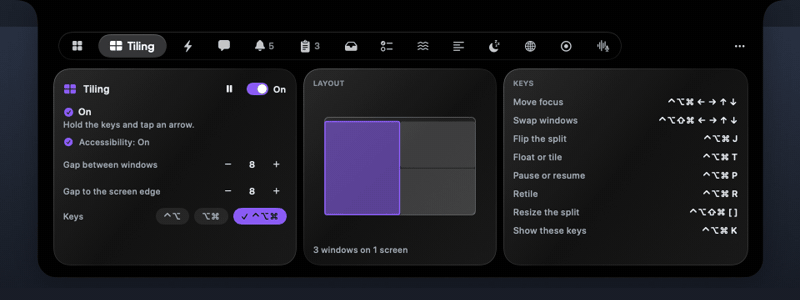

## Dictation and Polyglot

Hold the dictation key, speak, release to type.

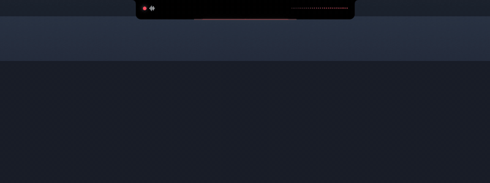

| Polyglot | Teleprompter |
| --- | --- |
| 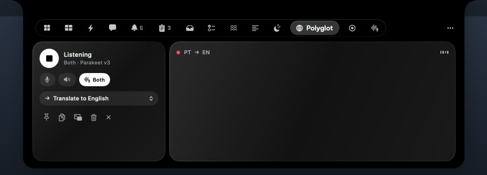 | 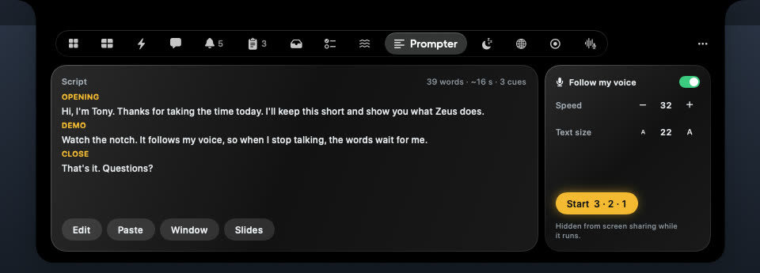 |

## Settings

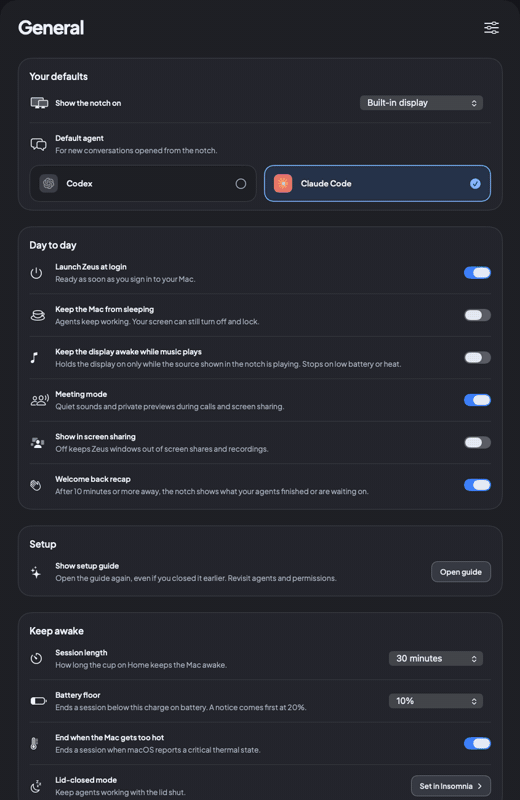

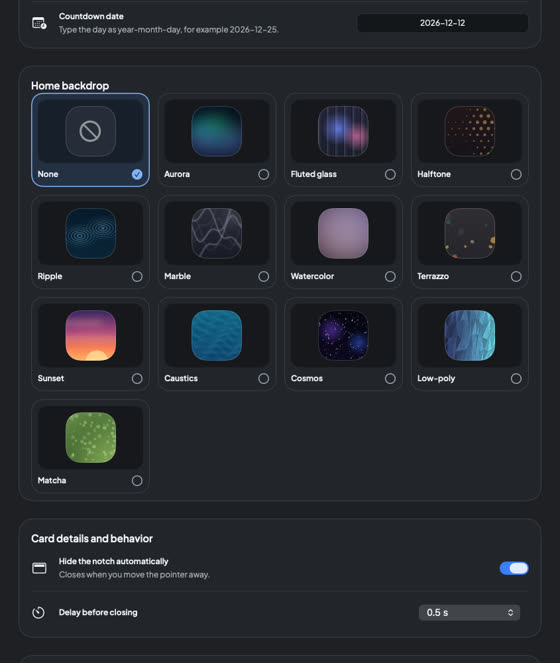

## Onboarding

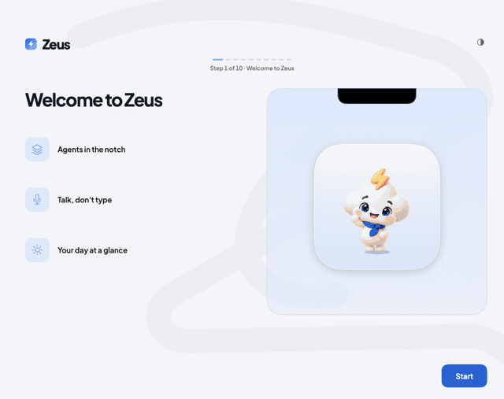

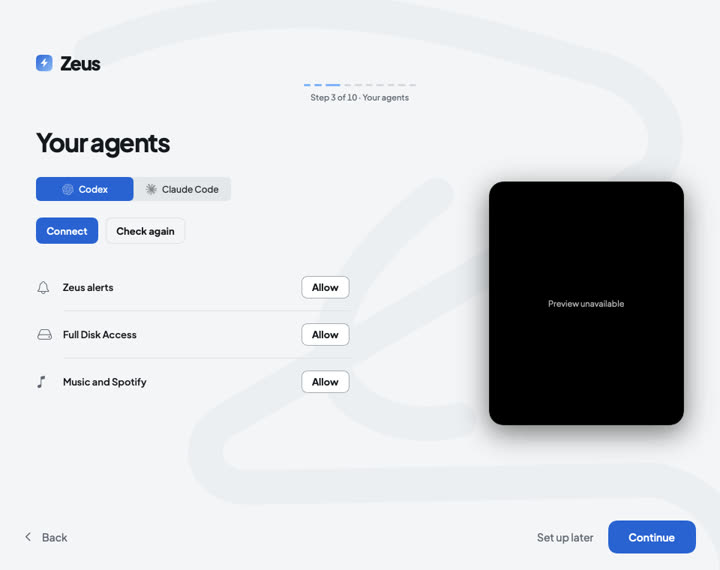

## Lights and halos

Halos and entrance lights for volume, copy, caps lock, battery, reminders and timers. They respect Reduce Motion.

