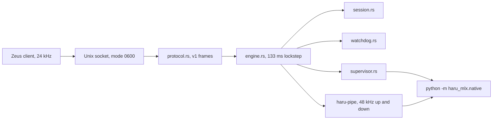
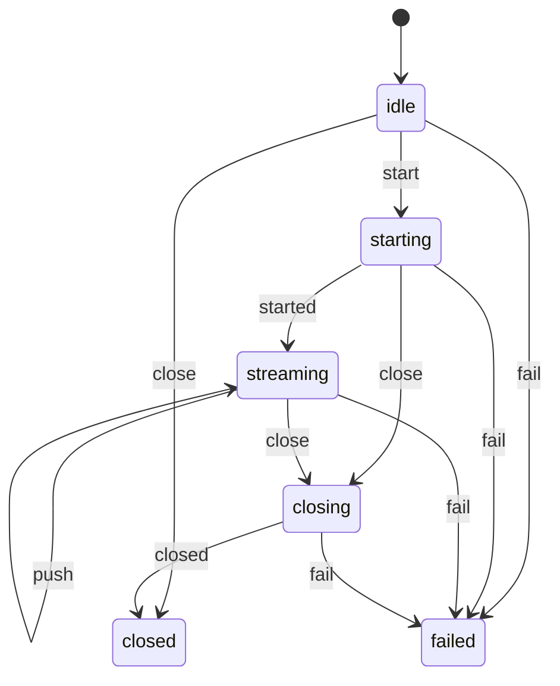

# haru-companion

A local supervisor for one Haru conversation. Zeus talks to it over a
Unix socket at 24 kHz. The companion owns the session, the watchdog, and
the child process. It does not download weights and it does not open a
TCP connection.

The model, when a launch is allowed, is `haru-speech-mlx` 0.1.0:

```
python -m haru_mlx.native --socket <private> --model <dir> --quantize 8
```

`--kv-window` and `--reanchor-minutes` are accepted and held. They are
not forwarded. Protocol v1 has no `reference_path`.

`haru-pipe` (`../haru-pipe`) is the Apache-2.0 path dependency. It has
no crates.io dependencies of its own and does the 48 kHz ↔ 24 kHz
conversion (`downsample_2x` / `upsample_2x`).

## Architecture



Zeus sends 24 kHz frames. A real child speaks 48 kHz. The companion
upsamples each push toward the child and downsamples each model frame
back to 3200 samples. A push that is not ready within 133 ms becomes
one silence frame and increments `underruns`. Each push still returns
exactly one frame.

`serve` binds the socket, checks that the interpreter can be spawned,
then accepts one client whose uid matches this process. When that
client disconnects, the session closes, the child is signalled, and
the socket file is removed. A missing interpreter exits 2 and leaves
no socket behind.

## Session state machine

The table is an exhaustive nested match with no wildcard arm. `failed`
and `closed` are terminal. Recovery is a new session, not a transition
out of `failed`.



Anything else is `illegal_transition` and does not move the session. A
push of the wrong length is `bad_frame_size` and also does not move it.

The drawing in [`docs/state-machine.svg`](docs/state-machine.svg) is
generated from `SessionState::next`. The moving dot walks the legal
path idle → starting → streaming → closing → closed.

Close from `idle` lands in `closed`, so a later start is refused and
no child is spawned. Close during `starting` goes `closing` then
`closed`, kills the child, and a late `started` is refused. A client
that drops without `CLOSE` ends the session the same way. A restart
kills the previous pid before it opens a fresh idle session.

## How to run

```
haru-companion serve --socket PATH --python PATH --model DIR [--quantize 8] [--watchdog] [--kv-window N] [--reanchor-minutes M]
haru-companion selftest [--frames N]
```

`selftest` runs an in-process fake session and prints overhead
percentiles and RSS. It does not spawn, bind, or use the network.
`--frames` is capped at 20000. `--watchdog` turns the watchdog on for
that process. With the conversation flag off (`LaunchRequest::default`),
`decide` returns `NoLaunch { FlagOff }` and nothing is spawned or bound.

```
cd native/haru-companion && cargo fmt --check
cargo clippy --locked --all-targets -- -D warnings
cargo test --locked
```

Repeat the three commands in `native/haru-pipe`. Both crates commit a
`Cargo.lock`. CI is `.github/workflows/haru-companion.yml` (ubuntu-latest,
path filter `native/**`, `contents: read`, no cache and no secrets).

## Wire protocol v1

Frame: `u8 type | u32 LE length | payload`. The socket is mode `0600`.
One client at a time. The peer uid must match the process. A length
above 8 MiB is rejected and the framer resynchronises. Strings are
Unicode. `en` and `fr` are the only languages.

| Dir | Type | Name | Payload |
| --- | --- | --- | --- |
| client → companion | `0x21` | HELLO | `{"v":1}` |
| client → companion | `0x22` | START | `language` `en` or `fr`, `system_prompt`, `speak_first` |
| client → companion | `0x23` | PUSH | `u32 seq` then `3200 × f32 LE` |
| client → companion | `0x24` | CLOSE | empty |
| companion → client | `0x31` | HELLO_ACK | `v`, `sample_rate` 24000, `frame_samples` 3200 |
| companion → client | `0x32` | STATE | `session`, `child`, `watchdog` |
| companion → client | `0x33` | FRAME | `u32 seq`, `f32 step_ms`, `3200 × f32 LE` |
| companion → client | `0x34` | TEXT | utf-8 |
| companion → client | `0x35` | ERROR | `code`, `message`, and for size `expected` and `got` |

A START object that contains `reference_path` is `reference_not_allowed`.
Upstream message types stay `0x01` AUDIO through `0x15` READY.

## Watchdog and restarts

`Ok → Pending → Restart → Cooldown → Ok`. Soft faults wait for idle: a
repeated token block, 3 unanswered turns, or 23 garbage frames. Hard
faults restart immediately: p95 step over 120 ms across 225 frames,
child RSS over 14 GB, no frame for 2 s while streaming, or a non-finite
step time. A memory report does not invent a latency sample. Garbage is
scored on the model frame, including one that was replaced by silence
because it missed the 133 ms lockstep.

After a restart the watchdog is in cooldown for 450 frames. The restart
budget is 3 per 10 minutes, then the child stays `stopped_failed`.
`process_exited`, `socket_closed`, and `start_timeout` are distinct
errors. An exit reported before launch, or after the supervisor has
stopped, does not spawn another child.

The child is reaped when it exits. Shutdown is SIGTERM, then SIGKILL
after a short grace. On Linux the child is armed with `PR_SET_PDEATHSIG`
so a crashed supervisor does not leave the interpreter running.
