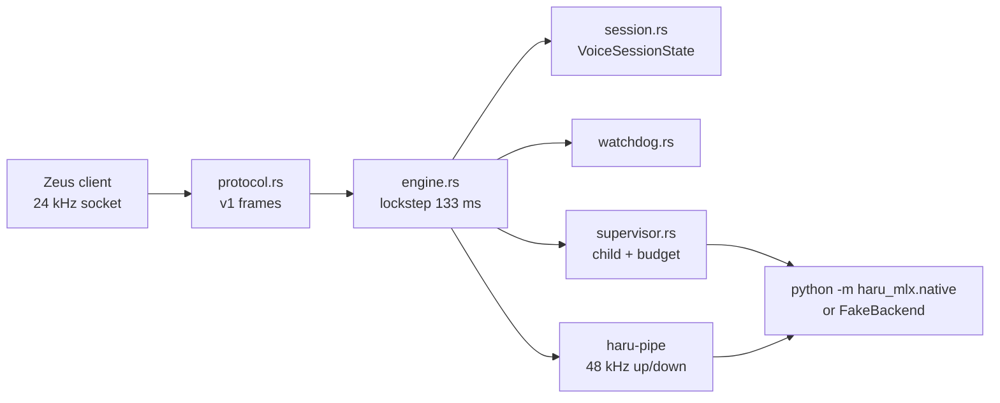

# haru-companion

One local process Zeus can talk to. It supervises a Haru child, speaks a
24 kHz socket protocol, and does not start a process, bind a socket, or open
a network connection unless `serve` is asked for with a Python interpreter
and a model directory.

This crate does not download weights. Tests use `FakeBackend` and synthetic
frames only. The model pin, when a real child is launched, is
`haru-speech-mlx` 0.1.0 (`python -m haru_mlx.native`), 8-bit, 24 kHz mono,
3200-sample frames. There is no `reference_path` in protocol v1.

`haru-pipe` is the path dependency (`../haru-pipe`). It is Apache-2.0, has
no crates.io dependencies, and does the 48 kHz ↔ 24 kHz conversion
(`downsample_2x` / `upsample_2x`).

## Commands

```
haru-companion serve --socket PATH --python PATH --model DIR [--quantize 8] [--watchdog] [--kv-window N] [--reanchor-minutes M]
haru-companion selftest [--frames 10000]
```

`serve` without `--python` or `--model` exits 2 and spawns nothing.
`--kv-window` and `--reanchor-minutes` are accepted and held. They are not
forwarded to `haru-speech-mlx` 0.1.0, whose CLI does not know them.
`selftest` runs an in-process fake session and prints overhead percentiles
and RSS. It does not spawn, bind, or use the network.

With the conversation flag off (`LaunchRequest::default`), `decide` returns
`NoLaunch { FlagOff }` and `apply` does not call the process, socket, or
network ports.

## Architecture



Zeus sends 24 kHz frames. The real child speaks 48 kHz. The companion
upsamples each push toward the child and downsamples each model frame back
to 3200 samples. A push that is not ready within 133 ms becomes one silence
frame and increments `underruns`. Each push still returns exactly one frame.

## Wire protocol v1

Unix socket, mode `0600`, one client, peer uid must match the process.
Frame: `u8 type | u32 LE length | payload`.

| Dir | Type | Name | Payload |
| --- | --- | --- | --- |
| client → companion | `0x21` | HELLO | `{"v":1}` |
| client → companion | `0x22` | START | `{"language":"en"\|"fr","system_prompt":"...","speak_first":bool}` |
| client → companion | `0x23` | PUSH | `u32 seq` then `3200 × f32 LE` (12804 bytes) |
| client → companion | `0x24` | CLOSE | empty |
| companion → client | `0x31` | HELLO_ACK | `{"v":1,"sample_rate":24000,"frame_samples":3200}` |
| companion → client | `0x32` | STATE | `{"session","child","watchdog"}` |
| companion → client | `0x33` | FRAME | `u32 seq`, `f32 step_ms`, `3200 × f32 LE` |
| companion → client | `0x34` | TEXT | utf-8 |
| companion → client | `0x35` | ERROR | `{"code","message"}` and, for size, `expected` and `got` |

A START object that contains `reference_path` is `reference_not_allowed`
and does not change the session. A PUSH whose sample count is not 3200 is
`bad_frame_size` with `expected: 3200` and does not change the session.
`bad_frame_size` is a different error from `illegal_transition`.

The child command, only after a launch is allowed, is:

```
python -m haru_mlx.native --socket <private> --model <dir> --quantize 8
```

Upstream message types are `0x01` AUDIO, `0x02` START, `0x03` PREPARE,
`0x10` HELLO, `0x11` FRAME, `0x12` TEXT, `0x13` ASSETS, `0x14` ERROR,
`0x15` READY.

## Session table

The machine mirrors the amended `VoiceSessionState` (PR #30 review, B1–B3):
an exhaustive nested match with no `_` arm. `failed` and `closed` are
terminal. Recovery is a new session, not a transition out of `failed`.

| State | start | started | push | close | closed | fail(e) |
| --- | --- | --- | --- | --- | --- | --- |
| idle | starting | illegal | illegal | **closed** | illegal | failed(e) |
| starting | illegal | streaming | illegal | **closing** | illegal | failed(e) |
| streaming | illegal | illegal | streaming | closing | illegal | failed(e) |
| closing | illegal | illegal | illegal | illegal | closed | failed(e) |
| closed | illegal | illegal | illegal | illegal | illegal | illegal |
| failed | illegal | illegal | illegal | illegal | illegal | illegal |

`illegal` is `illegal_transition`. A close that wins the race against start
lands in `closed`, so a later start is refused and no child is spawned.
Close during `starting` (the model-load await) goes `closing` then `closed`,
kills the child, and a late `started` is refused. The session never reaches
`streaming`.

`SessionError` also carries `process_exited`, `socket_closed`,
`start_timeout`, and `watchdog_restart`. The table test builds every state
and every event from exhaustive matches over those enums, then checks one
outcome per pair.

## Watchdog and restarts

`Ok → Pending → Restart → Cooldown → Ok`. Soft faults wait for idle: a
repeated token block in TEXT, 3 unanswered turns, or 23 garbage frames
(~3 s). Hard faults restart immediately: p95 step over 120 ms across 225
frames (30 s), child RSS over 14 GB, or no frame for 2 s while streaming.
After a restart the watchdog is in cooldown (450 frames, 60 s) and further
faults do not storm.

A restart records `failed(watchdog_restart)`, kills the child, and, inside
a budget of 3 restarts per 10 minutes, opens a fresh idle session. The old
pid is not left in the alive set. The same budget applies to
`process_exited` and `socket_closed`. Past the budget the child stays
`stopped_failed`.

## Check

```
cd native/haru-companion && cargo fmt --check
cargo clippy --locked --all-targets -- -D warnings
cargo test --locked -- --test-threads=1
```

Repeat the three commands in `native/haru-pipe`. Both crates commit a
`Cargo.lock`. CI for this lives in `.github/workflows/haru-companion.yml`
(ubuntu-latest, path filter `native/**`, `contents: read`, no cache and no
secrets). It was added only after Tony's card `t1983s8178`.

## Revert

This slice is new files only:

- `native/haru-companion/`
- `native/haru-pipe/`
- `.github/workflows/haru-companion.yml`

Revert the companion commits in reverse order, or delete those three paths.
Nothing under `Package.swift`, `Sources/`, `Tests/`, or the existing
workflows is modified.
