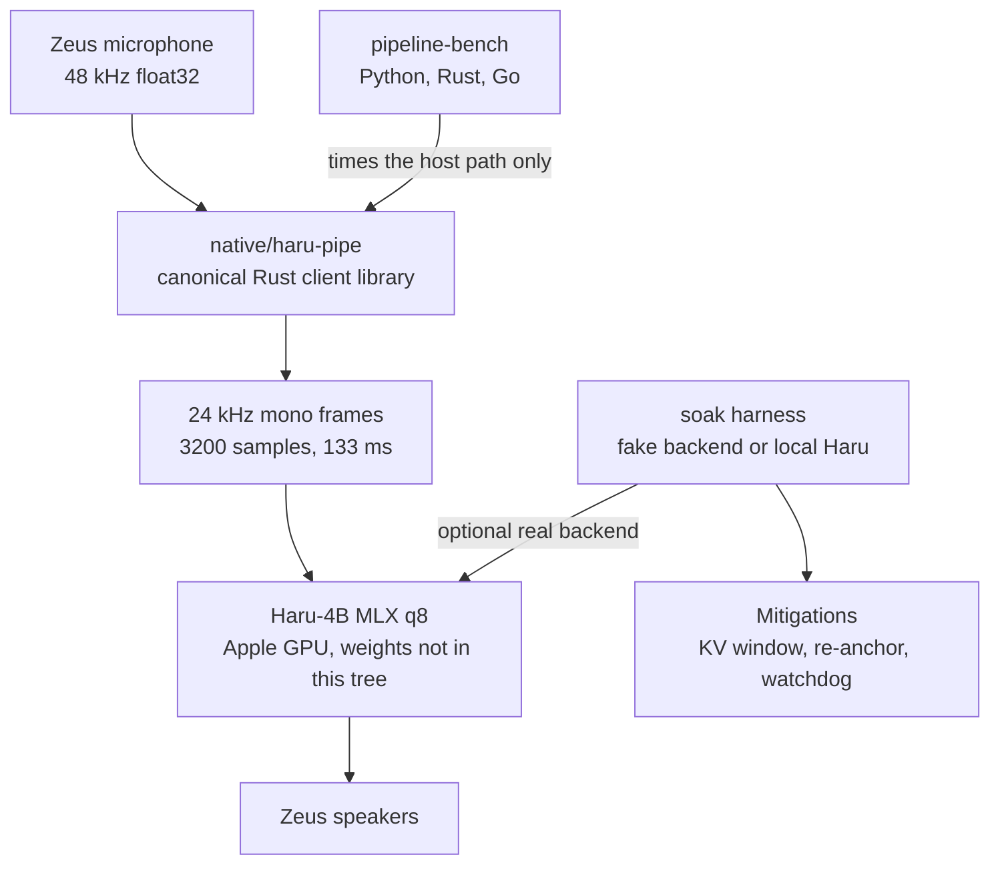

# Echo voice tooling

On-device voice tooling for Zeus, written by Echo. This tree is the Haru-4B
host path: a Python / Rust / Go benchmark of the audio pipeline, a long-run
soak harness with session mitigations, and the research and Mac run plan that
sit beside them.

The canonical `haru-pipe` crate is [`native/haru-pipe`](../../native/haru-pipe)
on branch `zeus-bot/haru-companion`. This tree keeps the benchmark's own
Rust sources at `pipeline-bench/rust/`.

Zeus stays a native macOS app. These files live only under `tools/echo-voice/`.
`Package.swift` does not list them, and there is no `Package.swift`, `Sources/`,
or `Tests/` directory here, so Swift Package Manager does not build this tree.

Haru-4B weights are absent. A real model run needs a local checkpoint that was
downloaded and hash-checked separately (see Licences).

## Layout

| Path | What it is |
|---|---|
| `native/haru-pipe` | Canonical Rust crate and `haru-pipe` CLI (branch `zeus-bot/haru-companion`). No dependencies and no model code. WAV I/O, int16↔float32, polyphase resample to 24 kHz, 3200-sample frames, ring and jitter buffers, and the `haru-mlx-native` socket frame format. |
| `pipeline-bench/rust/`, `pipeline-bench/go/`, `pipeline-bench/python/` | The three pipeline implementations the benchmark times. `pipeline-bench/rust/` builds on its own; it is the bench copy, and `native/haru-pipe` is the crate Zeus links. |
| `pipeline-bench/scripts/`, `pipeline-bench/results/`, `pipeline-bench/REPORT.md` | Workload, parity, and aggregate scripts, plus the measured pipeline report. |
| `bench/` | Haru-4B MLX benchmark (`haru_bench.py`) and the M5 summary. |
| `soak/` | Long-session harness (`haru_soak.py`), persona cards, hash-locked Mac requirements, and `MAC_RUN_PLAN.md`. |
| `research/`, `plan/` | Haru and TTS research notes, and the Zeus voice plan. |



`native/haru-pipe` is the host contract a Zeus client can link without Python.
The model step stays in Haru's MLX runtime. The benchmark replaces that step
with a stand-in (`frame t+1 = clip(0.5 · user frame t)`). The soak harness can
drive the real `DuplexSession` on a Mac, or a fake backend that injects
loops, drift, leaks, and garbage audio.

## Measured results

Two different machines. Do not add the numbers together as one end-to-end
measurement.

### Haru-4B on an Apple M5

From `bench/results/summary.md`. Machine: Apple M5, 32 GB, macOS 27.2, run
2026-11-20 17:40–17:50 BRT. Software: haru_mlx 0.1.0
(`7fe6b7665f8bf035998f401f8cb779fbe53f2751`), mlx 0.32.4, Python 3.12.13,
Hugging Face revision `8d6e83bcd3701a76fc27a764965665da1df7da78`. Five French
and five English items, seed 0, 16 warm-up frames, synthetic `say` voices,
no voice reference. One frame is 3200 samples at 24 kHz, which is 133.3 ms
of audio. RTF is compute time divided by audio time. Below 1 is faster than
real time.

| Run | Plain p50 | Plain RTF | Peak MLX |
|---|---:|---:|---:|
| q8 French | 80.81 ms/frame | 0.609 | 7.41 GB |
| q8 English | 79.59 ms/frame | 0.604 | 7.35 GB |
| bf16 French | 121.49 ms/frame | 0.917 | 11.28 GB |
| bf16 English | 135.61 ms/frame | 1.058 | 11.15 GB |

8-bit is the usable setting: about 80 ms per 133 ms frame, RTF about 0.60,
and a 7.4 GB MLX peak. bf16 English is slower than real time.

Caveats:

- The instrumented stage sum for q8 French is 86.55 ms, higher than the plain
  p50 of 80.81 ms, because instrumentation syncs after every stage. Of that
  budget, the LM step is 48.44 ms and the host stage is 0.04 ms.
- The published "65 ms" figure is an M1 Max measurement with the int8 native
  Swift app. It is a different machine and a different build.
- The M5 bandwidth floor (about 29 ms for the LM) is an estimate from public
  memory-bandwidth specs, not a measurement from this run.
- Each number was re-read from that run's `report.json`. The raw
  `echo-haru-results.tgz` is not in this tree.

### Host pipeline on Linux x86

From `pipeline-bench/REPORT.md`. Machine: Intel Xeon, 8 vCPU, KVM, 16 GB,
Linux x86-64. Toolchains: Python 3.13.5, numpy 2.5.5, scipy 1.18.1,
soundfile 0.14.0, rustc 1.85.1 (release, fat LTO), go 1.27.3. Seven
interleaved runs, medians. The model stage in the end-to-end rows is
simulated.

| Stream path, per frame | p50 | p95 |
|---|---:|---:|
| Python | 0.1246 ms | 0.1607 ms |
| Rust `haru-pipe` | 0.0181 ms | 0.0215 ms |
| Go | 0.0358 ms | 0.0443 ms |



The picture uses the unrounded medians in `pipeline-bench/results/summary.json`: Python p50 0.124581 ms and p95 0.160699 ms, Rust p50 0.018127499999999998 ms and p95 0.02150425 ms, Go p50 0.035847 ms and p95 0.044256149999999994 ms. The table above is that file rounded to four decimals, the same rounding as `pipeline-bench/results/table.md`.

On the stream path Rust takes 0.018 ms per frame and Python takes 0.125 ms
(6.9×). Rust also uses 0.71 s of CPU per run against Python's 3.90 s (5.5×)
and peaks at 223 MB RSS against Python's 431 MB. Go sits between them
(0.036 ms per frame, 0.99 s CPU, 291 MB).

Caveats:

- This is the host glue, measured on a shared Linux VM. Load average started
  at 5.9, so the absolute times are noisy. The ratios held across all seven
  runs.
- On the M5, the Python host stage inside a real Haru frame is 0.04 ms, which
  is about 0.05% of the 80.81 ms q8 frame. Replacing that glue with Rust can
  save at most that host stage. It is a client library, and the LM step is
  where the frame time goes.
- Rust and Go match each other bit for bit. Against Python, the stream path
  is bit-identical. The file path differs by at most 1 int16 LSB on at most
  0.174% of samples, from float32 summation order inside `resample_poly`.
- Rows marked simulated in the report add a fixed 86.55 ms model wait. They
  are not M5 measurements.

The Mac soak in `soak/MAC_RUN_PLAN.md` has not been run. `haru_soak.py
selftest` exercises the harness with the fake backend only.

## How to run

### Rust pipeline

The crate to build is [`native/haru-pipe`](../../native/haru-pipe) on branch
`zeus-bot/haru-companion`.

The benchmark's own copy at `pipeline-bench/rust/` builds standalone:

```sh
cd tools/echo-voice/pipeline-bench/rust
cargo build --release
```

`cargo build` writes `target/release/haru-pipe`, which this tree ignores.
`scripts/run_bench.py` expects that release binary.

### Go pipeline

```sh
cd tools/echo-voice/pipeline-bench/go
go test ./...
go build -o /tmp/haru-pipe ./cmd/haru-pipe
```

The module is `echo.local/harupipe` and uses only the standard library.
A binary named `haru-pipe` left in this directory is gitignored.

### Pipeline benchmark

The checked-in medians are in `pipeline-bench/results/` and
`pipeline-bench/REPORT.md`. Regenerating them needs scipy, soundfile, a
release build of the Rust and Go CLIs, and a deterministic WAV workload
from `scripts/gen_workload.py` (about 170 MB, gitignored):

```sh
cd tools/echo-voice/pipeline-bench
python3 -m venv .venv
.venv/bin/pip install numpy scipy soundfile
.venv/bin/python scripts/gen_workload.py workload
(cd rust && cargo build --release)
(cd go && go build -trimpath -o haru-pipe ./cmd/haru-pipe)
.venv/bin/python scripts/run_bench.py --runs 7 --e2e-runs 7
.venv/bin/python scripts/aggregate.py
```

### Model benchmark

`bench/haru_bench.py` never downloads a checkpoint. `selftest` checks the
pure helpers and needs no MLX:

```sh
python3 tools/echo-voice/bench/haru_bench.py selftest
```

A real run needs macOS, a venv with the pinned `haru-speech-mlx` and mlx, and
a local `--model` directory. See the module docstring and
`research/haru-research.md`.

### Soak harness

`selftest` is the portable check. It uses the fake backend, needs numpy, and
does not load Haru:

```sh
cd tools/echo-voice
python3 -m venv soak/venv
soak/venv/bin/pip install numpy
soak/venv/bin/python soak/haru_soak.py selftest
```

The last line is `selftest: N checks passed`. The v2 plan in
`soak/MAC_RUN_PLAN.md` records 59 checks.

The Mac matrix (about 2.1–2.4 hours, eight runs plus fault cases) is
`soak/MAC_RUN_PLAN.md`, driven by `soak/run_all.sh`. It downloads the 10.54 GB
checkpoint into `~/echo-haru-soak` and needs approval before anyone runs it.
The harness will not download on its own: `--model` must already be a local
directory.

Mitigations, all in `haru_soak.py`:

| Switch | Behaviour |
|---|---|
| `--kv-window N` | Keep the prompt plus the last N KV positions. Experimental: Haru was not trained with evicted context. |
| `--reanchor-minutes M` | Start a fresh session, and re-run the system prompt, at the next idle turn. |
| `--watchdog` | Restart on a token loop, unanswered turns, or garbage audio at the next idle turn. Restart immediately when latency or MLX memory crosses the hard limit. |
| `--temperature`, `--top-p`, `--dry`, `--dry-multiplier`, `--eop-bias` | Upstream sampling knobs, reached through the API. |

## Licences

Haru's code and its published weights are Apache-2.0
([Haru](https://github.com/higurashi-ai/Haru),
[model card](https://huggingface.co/higurashi-ai/Haru-4B)). The weights are
not in this tree. The pinned file, if fetched separately, is
`model.safetensors` revision `8d6e83bcd3701a76fc27a764965665da1df7da78`,
10,540,113,510 bytes, sha256
`ad2c3534ef6bd88525e22e5da3ac4fb739368406bf3b1c852cbafbade647c0fa`.

`native/haru-pipe` is Apache-2.0, declared in that crate's `Cargo.toml`.
The benchmark copy at `pipeline-bench/rust/Cargo.toml` carries the same
licence line. Neither copy contains model code.

Notes from `research/haru-research.md`, which are part of the licence
picture and are not a substitute for the upstream notices:

- The VibeVoice codec architecture and the weights inside it are MIT
  (Microsoft).
- The web client derives from Moshi (MIT). The MLX Qwen3.5 code derives
  from mlx-lm (MIT).
- The Qwen3.5 upstream weight licence is not stated in the Haru repository,
  so it is unverified there.

`soak/requirements.txt` is a hash-locked pip-compile lock for the Mac
benchmark environment (mlx 0.32.4 and its dependencies). It is a lockfile,
not a grant to install those packages on a CI machine.
